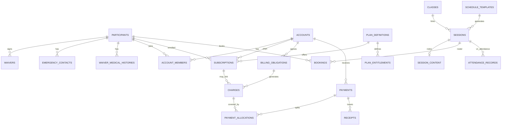

# Data model

Main gym entities in the **TU** Supabase project (not Terpsichora). This is a map; the schema source of truth is [TU-api `supabase/migrations/`](https://github.com/palthol/TU-api/tree/develop/supabase/migrations) and [database-overview.md](https://github.com/palthol/TU-api/blob/develop/docs/database-overview.md).

Money is **integer cents**. Business calendar dates use **America/New_York**.

Scheduling v2 tables (`classes`, `session_content`, `bookings`) and payer `billing_obligations` are **in git on `develop`**. Treat them as the intended model; confirm production application in [current-state.md](https://github.com/palthol/TU-api/blob/develop/docs/current-state.md) before operating as if they exist live.

## Entity-relationship overview

## By domain

### Waivers

| Entity | Role |
| --- | --- |
| `participants` | The person who trains (identity). Placeholder flags are planned — see [placeholder-enrollment.md](flows/placeholder-enrollment.md). |
| `waivers` | One signed submission (a person may have several over time) |
| `emergency_contacts` | Per submission |
| `waiver_medical_histories` | Per submission |
| `audit_trails` | Per submission |
| `view_waiver_documents` | Joined read model for PDF / staff review |

Public create path: `POST /api/waivers/submit` from [TU-Signup](https://github.com/palthol/TU-Signup). Staff review: dashboard People + waiver viewer. Payload shape: [frontend-backend-payload.md](https://github.com/palthol/TU-api/blob/develop/docs/frontend-backend-payload.md).

### People, accounts, families

| Entity | Role |
| --- | --- |
| `participants` | Who is on the mat |
| `accounts` | Who pays (household or individual) |
| `account_members` | Link with role `member` / `payer` / `guardian` |

Conceptually: **accounts pay; participants consume.** Payments post to accounts, not to a person row.

### Billing

| Entity | Role |
| --- | --- |
| `plan_definitions` | Catalog (name, cadence, price cents, active) |
| `plan_entitlements` | What a plan allows (group sessions, private minutes, reset rules) |
| `subscriptions` | Enrollment: this participant, this account, this plan, these dates |
| `billing_obligations` | Explicit payer agreement and cycle (in-repo; production apply gated) |
| `charges` | What is owed |
| `payments` | What was received |
| `payment_allocations` | Which payment covers which charge |
| `receipts` | Issued proof (void/supersede, do not silently edit) |
| `personal_finance_entries` | Quick cash log / light invoice drafts (receipts app) |
| `operating_expenses` | Gym expenses |

Enrollment RPC: `create_subscription`. Bulk enroll of existing people: CLI from [TU-api #69](https://github.com/palthol/TU-api/pull/69) — [runbook](runbooks/subscription-enrollment-backfill.md). **Billing cron is off.**

Design: [recurring-billing-obligations.md](https://github.com/palthol/TU-api/blob/develop/docs/recurring-billing-obligations.md), [finance-subsystem-design.md](https://github.com/palthol/TU-api/blob/develop/docs/finance-subsystem-design.md).

### Scheduling

| Entity | Role |
| --- | --- |
| `classes` | Weekly catalog (instructor, ISO weekday, America/New_York start, duration, capacity) |
| `schedule_templates` | v1 recurring template used by `generate_sessions` |
| `sessions` | A concrete class meeting; optional `class_id` |
| `session_content` | Per-session staff notes + HTTPS video + visibility (`staff` / `members` / `public`) |
| `bookings` | Staff-operated roster: capacity, FIFO waitlist with auto-promote, late cancel within 3 elapsed hours, check-in, no-show |
| `attendance_records` | v1 attendance (unchanged by booking slice) |

Public list: `GET /api/calendar/classes` (active classes). Occurrences: `GET /api/calendar/occurrences`. Bookings attach to **existing session rows**; the 14-day occurrence list is not auto-materialized into sessions.

Lane plan: [scheduling/README.md](https://github.com/palthol/TU-api/blob/develop/docs/scheduling/README.md).

### Admin / security

| Entity | Role |
| --- | --- |
| `app_admin` | Auth users who may pass RLS as admin (dashboard SQL / service role to insert) |
| `staff_users` | Personal `x-admin-key` hashes and RBAC roles |
| `staff_audit_events` | Mutating admin actions |
| `event_ledger` | Append-only operational events |

RLS is on for gym tables. Browser apps of the **gym** product still go through the API with the service role on the server. Terpsichora's graph tables are a **different database**.

### Terpsichora (separate)

Technique nodes, edges, curricula, progress — see [Terpsichora ARCHITECTURE.md](https://github.com/palthol/Terpsichora/blob/develop/docs/ARCHITECTURE.md). Those tables are not drawn above. Later, technique nodes link **out** to TU session notes/videos; they do not become classes.

## Where to read more

| Topic | Doc |
| --- | --- |
| Table list and what the DB does not do | [database-overview.md](https://github.com/palthol/TU-api/blob/develop/docs/database-overview.md) |
| HTTP shapes | [admin-api.md](https://github.com/palthol/TU-api/blob/develop/docs/admin-api.md) |
| Live vs in-repo schema | [api-schema-audit.md](https://github.com/palthol/TU-api/blob/develop/docs/api-schema-audit.md) |
| Capability matrix | [api-capability-audit.md](https://github.com/palthol/TU-api/blob/develop/docs/api-capability-audit.md) |
| Status | [current-state.md](https://github.com/palthol/TU-api/blob/develop/docs/current-state.md) |
