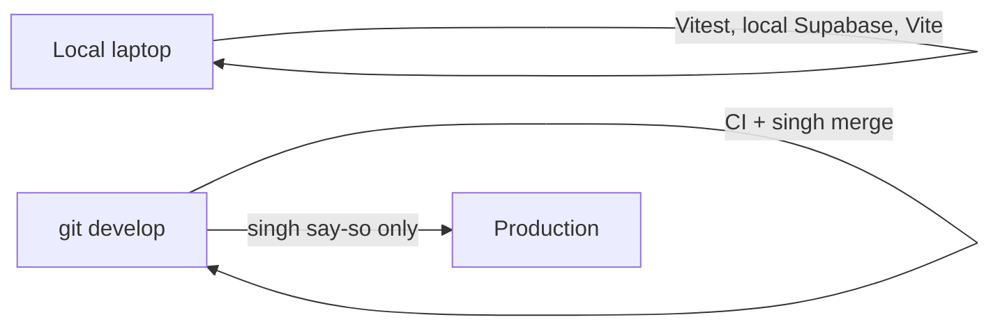

# Environments

Local, develop, and production for Temple Underground software. **Config names only — never values.**

Gym timezone: America/New_York. Production writes, migrations, deploys, and key rotation need **singh's explicit OK**.

## Two Supabase projects

| Project | Used by | Hosted project ref |
| --- | --- | --- |
| **TU** (gym) | TU-api, TU-Signup, TU-Administrative | `jhxzecxkccqlgyazhsnb` |
| **Terpsichora** (technique graph) | Terpsichora app only | **TODO: verify** (not recorded in Terpsichora `.env.example`; local CLI id is `Terpsichora`) |

These are **separate**. Do not point TU-api at the Terpsichora project, or Terpsichora at the gym project. Terpsichora has no classes or calendar.

The TU production project is **sometimes paused** (Supabase inactivity pause). Resume: [runbooks/resume-paused-supabase.md](runbooks/resume-paused-supabase.md). Current paused/active state: **TODO: verify** at resume time.

## Environment layers

| Layer | API / apps | Database | Purpose |
| --- | --- | --- | --- |
| **Local** | API `:3001`; dashboard `:5174`; receipts `:5176`; waiver viewer `:5177`; signup Vite (TU-Signup README says `:5174` — **TODO: verify** port clash with dashboard) | Local Supabase from TU-api (`127.0.0.1:54321` API, `:54322` DB, Studio `:54323`) | Disposable. Seed/cleanup scripts. Never production keys. |
| **develop** | Git integration branch for TU-api and TU-Administrative. CI on PRs and pushes. | Not a hosted "develop database". CI pgTAP uses **local** Supabase in GitHub Actions. | Merge target for small PRs. |
| **Production** | API on Render; staff/public UIs on Vercel custom domains | Hosted TU project `jhxzecxkccqlgyazhsnb` | Live gym. Out of bounds for tests, seeds, and agent writes. |

TU-api docs: there is **no supported Render preview API** today (no `render.yaml`; dashboard unread). If a preview API is added later, it must use a **non-production** Supabase project, never `jhxzecxkccqlgyazhsnb`.

Terpsichora default git branch is `master` (also `main` / `develop`). TU-Signup has `main` only.

## Where config lives (names)

Never commit `.env`, webhook URLs, JWTs, or key material. Copy from `*.example` files.

### TU-api (`services/api/.env.example` and [deployment.md](https://github.com/palthol/TU-api/blob/develop/docs/deployment.md))

| Name | Role |
| --- | --- |
| `PORT` | Listen port (Render sets this; local default 3001) |
| `SUPABASE_URL` | TU project URL |
| `SUPABASE_SECRET_KEY` | Server-only secret (`sb_secret_` preferred) |
| `SUPABASE_SERVICE_ROLE_KEY` | Legacy; used only if `SUPABASE_SECRET_KEY` is unset |
| `SUPABASE_PUBLISHABLE_KEY` | Auth password sign-in (`sb_publishable_` preferred) |
| `SUPABASE_ANON_KEY` | Legacy anon; used only if publishable unset |
| `ADMIN_API_KEY` | Shared `x-admin-key` (owner compatibility) |
| `SESSION_SECRET` | Cookie sessions (`>= 32` chars) |
| `SESSION_SECRET_PREVIOUS` | Decrypt-only during rotation |
| `ADMIN_EMAIL` / `ADMIN_USER_ID` | singh's Auth user for cookie login |
| `ADMIN_ALLOWED_ORIGINS` | Credentialed CORS + CSRF allowlist for admin UIs |
| `ALLOWED_ORIGIN` | Public CORS (defaults to `*` if unset) |
| `TRUST_PROXY` | Render hop count (default `1`; do not set `true`) |
| `CRON_SECRET` | `x-cron-secret` for digest / billing generate |
| `DISCORD_WEBHOOK_URL` / `SLACK_WEBHOOK_URL` | Names only; values stay in the host dashboard |
| `STRIPE_WEBHOOK_SECRET` | Inbound webhook verify |
| `TURNSTILE_SECRET_KEY` | Optional public POST siteverify |
| `SIGNATURES_BUCKET` / `WAIVERS_BUCKET` | Storage bucket names |
| Rate/JSON limits | `LEAD_*`, `WAIVER_SUBMIT_*`, `CALENDAR_OCCURRENCES_*` |

Full list: the example file above. Optional Cloudflare Access names exist for a legacy viewer path; the current waiver viewer uses staff-key / SSO like the other admin apps.

### TU-Administrative (`apps/*/.env.example`)

| Name | Role |
| --- | --- |
| `VITE_API_BASE_URL` | API origin override (prod default `https://api.templeunderground.com`) |
| `VITE_LOGIN_URL` | SSO redirect (prod default `https://admin.templeunderground.com/login`) |
| `VITE_RETURN_TO_ORIGINS` | Extra https return_to origins for previews |
| `VITE_RECEIPTS_APP_URL` / `VITE_WAIVER_VIEWER_APP_URL` | Tool links |

Staff keys are **entered at runtime**. Never `VITE_ADMIN_API_KEY`.

### TU-Signup

| Name | Role |
| --- | --- |
| `VITE_API_BASE_URL` | Production API origin; omit locally to proxy `/api` to `:3001` |

### Terpsichora (`.env.example`)

| Name | Role |
| --- | --- |
| `VITE_SUPABASE_URL` | **Terpsichora** project URL |
| `VITE_SUPABASE_ANON_KEY` | Publishable/anon for the browser client |
| `SUPABASE_SERVICE_ROLE_KEY` | CLI importer only; never `VITE_*` |

### Host dashboards (not git)

| Place | What lives there |
| --- | --- |
| Render (API web service) | TU-api env names for production |
| Vercel (each app) | `VITE_*` public names |
| Supabase (each project) | Project URL, keys, pause/resume, Auth URL config |
| Render Cron Job | `CRON_SECRET` only (digest curl); webhook stays on the API service |

## CI (TU-api)

On pull requests and pushes to `develop` / `main` ([`.github/workflows/ci.yml`](https://github.com/palthol/TU-api/blob/develop/.github/workflows/ci.yml)):

| Check | What it does |
| --- | --- |
| **API tests** | `npm ci`, Vitest, waiver schema guard (dummy env only) |
| **Detect database changes** | Path filter on `supabase/**` and the CI workflow |
| **pgTAP (local Supabase)** | Local `supabase start` / `db reset` / `test db` when database paths change |
| **waiver-schema-guard** / **waiver-smoke-test** | Separate Waiver Guardrails workflow; smoke skips unless smoke secrets are set |

CI never sets hosted-project tokens and must not `supabase link` production.

## Pause / resume

Free or inactive Supabase projects can pause. A paused TU project makes `GET /health/deep` fail (`db: false`) and blocks waivers, admin, and receipts. Staff UIs may still load as static Vercel apps.

See [resume-paused-supabase.md](runbooks/resume-paused-supabase.md).

## Further reading

- [TU-api validation-environment.md](https://github.com/palthol/TU-api/blob/develop/docs/validation-environment.md) — local seed/cleanup; production out of bounds
- [TU-api deployment.md](https://github.com/palthol/TU-api/blob/develop/docs/deployment.md)
- [TU-api use-guide.md](https://github.com/palthol/TU-api/blob/develop/docs/use-guide.md)
