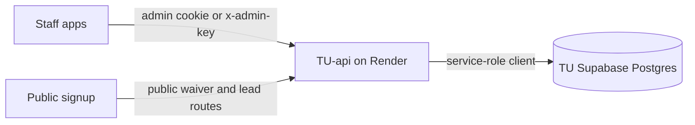

# How the API and the database relate

Plain-language guide for the gym owner. Technical contracts live in [TU-api](https://github.com/palthol/TU-api); this page explains *why* the pieces are arranged this way.

Temple Underground's gym records (people, waivers, money, classes) live in one **Supabase Postgres** database. Staff and public apps never write to that database themselves. They talk to an **API** on Render, and the API talks to the database.

## Two kinds of database access

Supabase exposes two different ways to reach Postgres:

| Kind | What it is | Who uses it |
| --- | --- | --- |
| **Row Level Security (RLS)** | Postgres rules on each table: "this login may only see rows it is allowed to see." | Browser clients that use a public/publishable key (Terpsichora does this on its *own* project). |
| **Service-role key** | A server-only credential that **bypasses RLS**. It can read and write anything the project allows. | TU-api only. Never in a browser, Vite `VITE_*` variable, or staff laptop bookmarklet. |

On the **TU gym database**, tables are admin-only at the RLS layer. Public waiver submit does **not** get an anonymous write policy. The API accepts the public form, checks it, and then writes with the service-role key. That is deliberate: the API is the policy layer (rate limits, honeypot, Turnstile, idempotency, PDF/storage, notifications).

**Why this matters:** if a staff app or the signup site held the service-role key, anyone who opened DevTools could read or change gym data. Keeping the key on the Render API is the accident boundary.

Legacy names: `SUPABASE_SECRET_KEY` is preferred; `SUPABASE_SERVICE_ROLE_KEY` is still accepted when the new name is unset. Publishable/anon keys (`SUPABASE_PUBLISHABLE_KEY` / `SUPABASE_ANON_KEY`) are for **Auth sign-in**, not for privileged table writes.

Source: [TU-api AGENTS.md](https://github.com/palthol/TU-api/blob/develop/AGENTS.md), [database-overview.md](https://github.com/palthol/TU-api/blob/develop/docs/database-overview.md), [deployment.md](https://github.com/palthol/TU-api/blob/develop/docs/deployment.md).

## Why apps go through the API (and not the database)

| App | Talks to | Must not |
| --- | --- | --- |
| Dashboard, receipts, waiver viewer ([TU-Administrative](https://github.com/palthol/TU-Administrative)) | `https://api.templeunderground.com` with a host-only admin cookie and/or `x-admin-key` | Hold the service-role key or become a second backend |
| Signup / waiver ([TU-Signup](https://github.com/palthol/TU-Signup)) | Public API routes such as `POST /api/waivers/submit` | Write to Postgres from the browser |
| Terpsichora | Its **own** Supabase project (technique graph). Not the gym database. | Treat TU class/calendar tables as its source of truth — it has none |

The API is responsible for:

- **AuthZ** — who may do the action (`owner` / `finance` / `front_desk`, cookie vs header, cron secret).
- **Validation** — money in integer cents, stable error keys, pagination.
- **Atomic writes** — multi-row money and identity changes go through RPCs (see below).
- **Side effects** — signature/PDF storage, Discord/Slack notifications, Stripe webhook mapping.

Ownership map: [application-ownership-and-data-flow.md](https://github.com/palthol/TU-api/blob/develop/docs/application-ownership-and-data-flow.md). HTTP contracts: [admin-api.md](https://github.com/palthol/TU-api/blob/develop/docs/admin-api.md).

Staff login uses cookie `__Host-tu_admin_session` (host-only on the API origin; `HttpOnly; Secure; SameSite=Strict`; no `Domain`). Vercel preview deployments **cannot** use that host-only cookie, so previews fall back to the runtime `x-admin-key` unlock. Scripts and CLIs keep using `x-admin-key`.

## Migrations: how the database schema changes

The schema is files in [TU-api `supabase/migrations/`](https://github.com/palthol/TU-api/tree/develop/supabase/migrations). They apply in filename order. Adding a table or RPC means adding a new timestamped file, never rewriting history that production already applied.

- **Local:** `supabase start` / `db reset` reapplies every file to a disposable database.
- **Production:** applying a migration **changes live gym data structures**. It needs [singh's explicit OK](runbooks/apply-migration-to-prod.md). Agents and this hub do not authorize `db push` to project `jhxzecxkccqlgyazhsnb`.

Some features exist in git (`develop`) but are **not** production-applied yet. Scheduling v2 (classes, session content, bookings) and payer-obligation billing are the large examples. See [current-state.md](https://github.com/palthol/TU-api/blob/develop/docs/current-state.md) before assuming production can do what `develop` can do.

CI job **Detect database changes** looks at `supabase/**` (and the CI workflow itself) and then runs **pgTAP (local Supabase)** against a throwaway local stack. It never links to the hosted project.

## RPCs: why some writes are database functions

An **RPC** here is a Postgres function the API calls as one transaction. If any step fails, nothing half-commits.

Examples (service-role execute only):

| RPC | Job |
| --- | --- |
| `create_subscription` | Enroll a person on a plan (optional initial charge) |
| `record_payment` | Payment + allocations + optional receipt in one shot |
| `merge_participants` | Combine duplicate people records |
| `generate_sessions` | Materialize session rows from a template |
| `book_session` / `cancel_booking` / `check_in_booking` / `mark_booking_no_show` | Staff roster on a session (capacity, waitlist, late cancel) |
| `generate_monthly_charges` | Create this period's charges from active billing obligations |

Prefer an RPC whenever several tables must change together (enrollment, payment, booking + waitlist promote). The API still decides *whether* to call the RPC and with which staff identity.

## What the database does not do by itself

- It does **not** charge cards. Stripe webhooks and manual payment recording write the ledger; generation of monthly *debt* is a separate RPC.
- It does **not** run the billing cron. The Cloudflare Worker source exists in TU-api (`workers/billing-cron/`) but the cron list is empty. **Billing cron is off.**
- It does **not** accept public waiver rows without the API.
- Charge generation and session generation run when something (API, operator, or a future approved scheduler) calls them.

## Further reading

- [system-map.md](system-map.md) — which app talks to which host
- [data-model.md](data-model.md) — entities
- [environments.md](environments.md) — local vs develop vs prod
- [TU-api current-state.md](https://github.com/palthol/TU-api/blob/develop/docs/current-state.md)
- [TU-api database-overview.md](https://github.com/palthol/TU-api/blob/develop/docs/database-overview.md)
