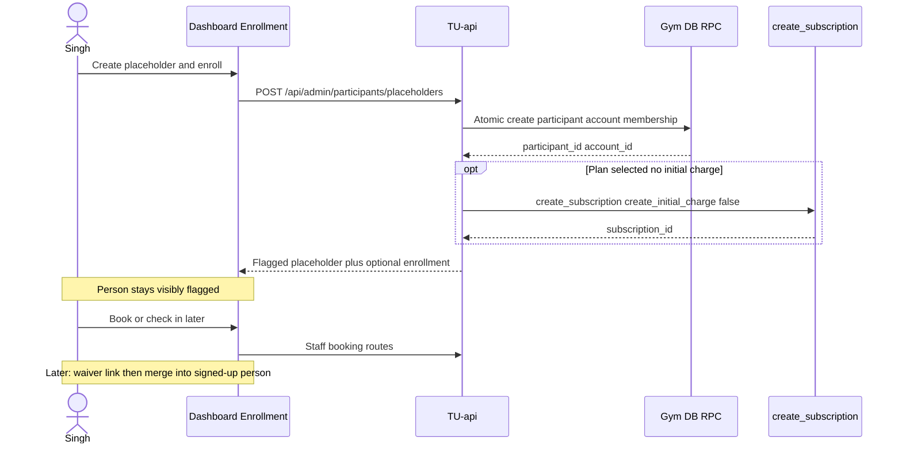
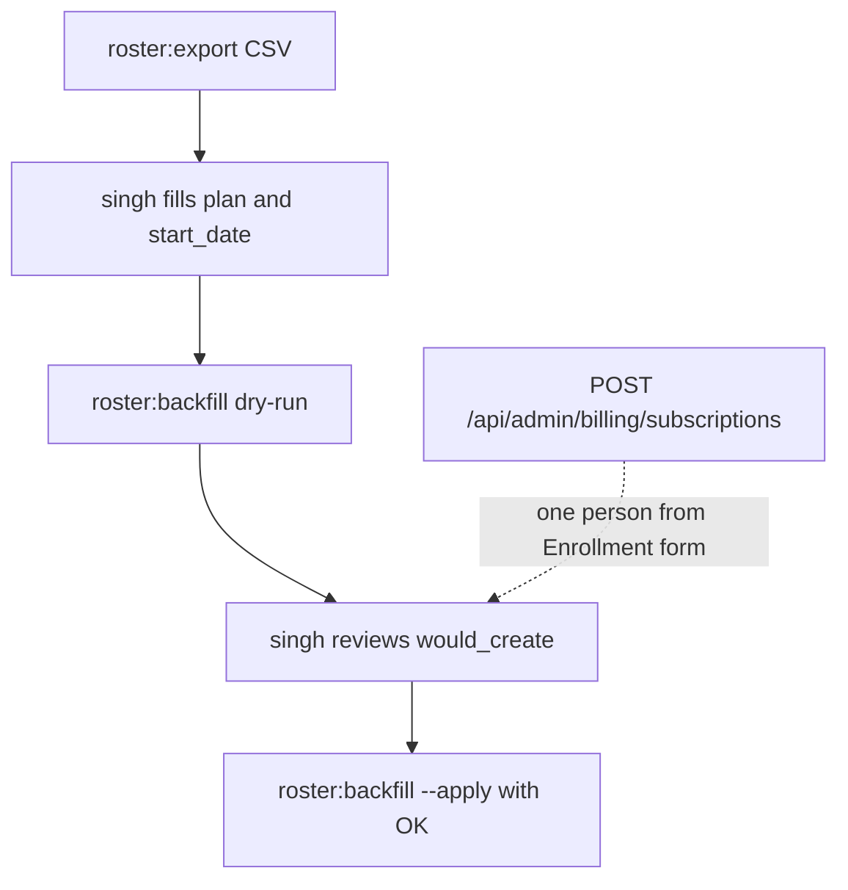

# Placeholder participants and enrollment

**Status: in progress — not yet merged.**  
**Checked:** 2026-11-24. No open pull requests and no `is_placeholder` / `enrollment-board` hits on TU-api `main` (GitHub code search indexes the default branch) or TU-Administrative `main`. **TODO: verify** PR numbers and branch names when the work is opened or merged.

This page describes the **intended** slice so singh and later PRs share one picture. Treat routes and columns as the design until they land on `develop`.

## Why

People show up and train before they complete the public waiver. Staff need a **visibly flagged** stand-in person who can be booked and checked in, without pretending they have a signed waiver or a known date of birth.

Later: send a waiver link, then merge the placeholder into the real signed-up participant.

Existing people (already in the DB from waivers) are enrolled with the #69 roster CLI, not this placeholder RPC. See [subscription-enrollment-backfill.md](../runbooks/subscription-enrollment-backfill.md).

## Intended schema (TU gym DB)

On `participants`:

| Column | Meaning |
| --- | --- |
| `is_placeholder` | This row is a stand-in, not a completed signup |
| `placeholder_reason` | Why (staff-entered) |
| `dob_is_placeholder` | Date of birth is unknown / stand-in |
| `dob_placeholder_reason` | Why the DOB is a stand-in |

Placeholders **may** book and check in **before** signing the new waiver. They stay flagged in every staff UI that lists people.

**TODO: verify** exact column types and check constraints when the migration file exists.

## Intended API

Admin-authenticated (cookie `__Host-tu_admin_session` and/or `x-admin-key`; RBAC **TODO: verify** — likely `owner` / `front_desk` write, `finance` read).

| Route | Job |
| --- | --- |
| `POST /api/admin/participants/placeholders` | Atomic RPC: create participant + account + membership; optionally enroll |
| `GET /api/admin/billing/enrollment-board` | Board of who is / is not enrolled |
| `POST /api/admin/billing/subscriptions` | Enroll (existing `create_subscription`; `create_initial_charge: false` when there should be no initial charge) |

The create-placeholder RPC may call `create_subscription` with **no initial charge**. Billing cron stays off.

## Intended dashboard (TU-Administrative)

Enrollment section:

1. **Board** — `GET /api/admin/billing/enrollment-board`
2. **Create placeholder and enroll** — placeholder POST, optional plan
3. **Enroll existing person** — `POST /api/admin/billing/subscriptions` for someone already in People

Current `develop` dashboard is People / Today / Classes / Billing / More; it does **not** yet ship this Enrollment section on `main`. **TODO: verify** against the feature branch when it exists (`noble-6/finance-roster-enrollment-171a` is a related receipts/enrollment-adjacent branch — **TODO: verify** whether it includes placeholders).

## Sequence (create placeholder and optionally enroll)

## Existing-person enrollment (already shipped tooling)

CLI details: [TU-api #69](https://github.com/palthol/TU-api/pull/69) and [subscription-backfill.md](https://github.com/palthol/TU-api/blob/develop/docs/subscription-backfill.md). `--apply` is singh-only.

## Later (not this slice)

- Waiver link for the placeholder
- Merge placeholder into the real signed-up person (TU-api already has `merge_participants` for duplicates; whether placeholders reuse it is **TODO: verify**)
- Clearing `is_placeholder` only after a signed waiver exists

## PR status log

| Repo | PR | State |
| --- | --- | --- |
| TU-api | **TODO: verify** | Not found open as of 2026-11-24; not on default-branch search |
| TU-Administrative | **TODO: verify** | Same |

When PRs open, add them here and keep this flow marked **in progress** until both are merged to `develop` and released per [release-develop-to-main.md](../runbooks/release-develop-to-main.md).
