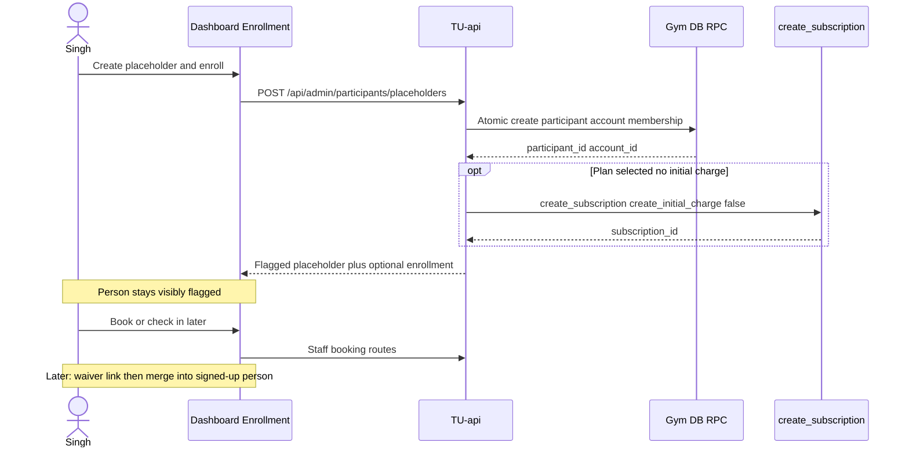
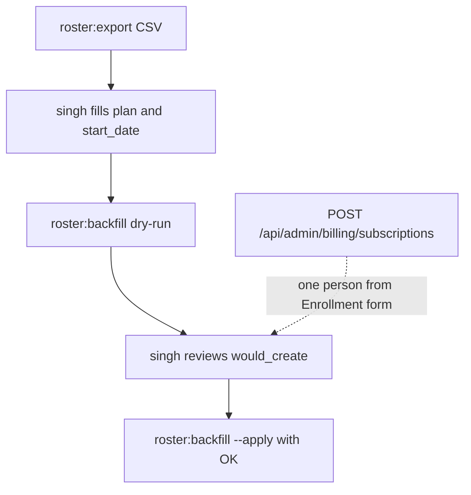

# Placeholder participants and enrollment

**Status: in progress — open PRs into `develop`, not merged.**

| Repo | PR | Base | Merged? |
| --- | --- | --- | --- |
| TU-api | [#72 Placeholder participants and no-charge enrollment](https://github.com/palthol/TU-api/pull/72) | `develop` | No |
| TU-Administrative | [#18 Add Enrollment board and placeholder subscription enrollment](https://github.com/palthol/TU-Administrative/pull/18) | `develop` | No |

**CI:** GitHub Actions is currently blocked by an **account billing lock**, so CI has not run on these PRs yet.

This page summarizes that slice. Treat routes and columns as the PR contracts until they land on `develop`.

## Why

People show up and train before they complete the public waiver. Staff need a **visibly flagged** stand-in person who can be booked and checked in, without pretending they have a signed waiver or a known date of birth.

Later: send a waiver link, then merge the placeholder into the real signed-up participant.

Existing people (already in the DB from waivers) are enrolled with the #69 roster CLI, not this placeholder RPC. See [subscription-enrollment-backfill.md](../runbooks/subscription-enrollment-backfill.md).

## Intended schema (TU gym DB)

On `participants`:

| Column | Meaning |
| --- | --- |
| `is_placeholder` | This row is a stand-in, not a completed signup |
| `placeholder_reason` | Why (staff-entered) |
| `dob_is_placeholder` | Date of birth is unknown / stand-in |
| `dob_placeholder_reason` | Why the DOB is a stand-in |

Placeholders **may** book and check in **before** signing the new waiver. They stay flagged in every staff UI that lists people.

Migration on #72 (in-repo only): `20261124120000_placeholder_participants.sql`. Unknown DOB is stored as the stand-in date `1900-01-01` via `placeholder_date_of_birth()`. Email may be null for name-only members.

## Intended API

Admin-authenticated (cookie `__Host-tu_admin_session` and/or `x-admin-key`). Per [TU-api #72](https://github.com/palthol/TU-api/pull/72): placeholder **writes** are `owner` and `front_desk` (`finance` → `403`); enrollment-board **reads** are `owner`, `finance`, and `front_desk`; existing-person enroll writes are `owner`, `finance`, and `front_desk`.

| Route | Job |
| --- | --- |
| `POST /api/admin/participants/placeholders` | Atomic RPC: create participant + account + membership; optionally enroll |
| `GET /api/admin/billing/enrollment-board` | Board of who is / is not enrolled |
| `POST /api/admin/billing/subscriptions` | Enroll (existing `create_subscription`; `create_initial_charge: false` when there should be no initial charge) |

The create-placeholder RPC may call `create_subscription` with **no initial charge**. Billing cron stays off.

## Intended dashboard (TU-Administrative)

Enrollment section:

1. **Board** — `GET /api/admin/billing/enrollment-board`
2. **Create placeholder and enroll** — placeholder POST, optional plan
3. **Enroll existing person** — `POST /api/admin/billing/subscriptions` for someone already in People

That Enrollment section is in [TU-Administrative #18](https://github.com/palthol/TU-Administrative/pull/18), not on `develop` or `main` yet. Current `develop` dashboard remains People / Today / Classes / Billing / More.

## Sequence (create placeholder and optionally enroll)

## Existing-person enrollment (already shipped tooling)

CLI details: [TU-api #69](https://github.com/palthol/TU-api/pull/69) and [subscription-backfill.md](https://github.com/palthol/TU-api/blob/develop/docs/subscription-backfill.md). `--apply` is singh-only.

## Later (not this slice)

- Waiver link for the placeholder
- Merge placeholder into the real signed-up person (TU-api already has `merge_participants` for duplicates; whether placeholders reuse it is **TODO: verify**)
- Clearing `is_placeholder` only after a signed waiver exists

## PR status log

Checked 2026-11-24.

| Repo | PR | State |
| --- | --- | --- |
| TU-api | [#72](https://github.com/palthol/TU-api/pull/72) | Open into `develop`, not merged. CI has not run (GitHub Actions account billing lock). |
| TU-Administrative | [#18](https://github.com/palthol/TU-Administrative/pull/18) | Open into `develop`, not merged. Depends on #72's routes. Same billing-lock CI gap. |

Keep this flow marked **in progress** until both are merged to `develop` and released per [release-develop-to-main.md](../runbooks/release-develop-to-main.md).
