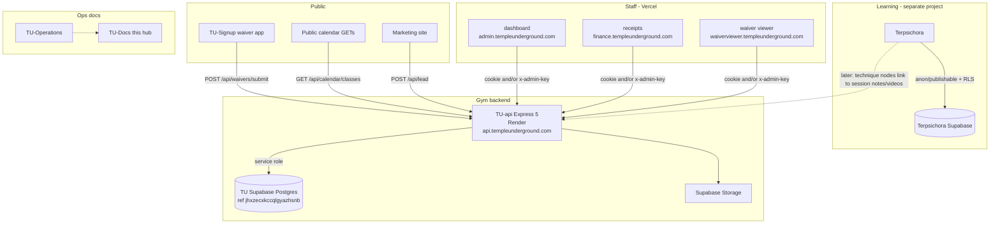

# System map

How Temple Underground's apps, API, databases, and hosts fit together.

singh is the only staff operator. Gym business time is America/New_York.

## Diagram

Terpsichora does **not** own classes or a calendar. Technique nodes will later link out to TU class-session notes and videos. A shared login with a future member portal is planned; it is not built yet.

## Hosts and domains

| Surface | Host | Platform | Repo |
| --- | --- | --- | --- |
| API | `https://api.templeunderground.com` (also `https://temple-underground-signup.onrender.com`) | Render | [TU-api](https://github.com/palthol/TU-api) |
| Dashboard | `https://admin.templeunderground.com` | Vercel | [TU-Administrative](https://github.com/palthol/TU-Administrative) `apps/dashboard` |
| Receipts / finance | `https://finance.templeunderground.com` | Vercel | TU-Administrative `apps/receipts` |
| Waiver viewer | `https://waiverviewer.templeunderground.com` | Vercel | TU-Administrative `apps/waiver-viewer` |
| Public waiver | Vercel project homepage `https://temple-underground-signup-waiver-v2-palthols-projects.vercel.app` | Vercel | [TU-Signup](https://github.com/palthol/TU-Signup) |
| Technique graph | `https://terpsichora.vercel.app` | Vercel | [Terpsichora](https://github.com/palthol/Terpsichora) |
| Marketing site | `https://www.templeunderground.com/` | **TODO: verify** host (listed as TU-api repo homepage) | Mentioned as sibling `TU-web` in TU-api docs |

**TODO: verify** whether TU-Signup has a custom `templeunderground.com` hostname besides the Vercel project URL.

Vercel **preview** URLs cannot use the host-only `__Host-tu_admin_session` cookie (it is bound to `api.templeunderground.com`). Previews use the runtime staff-key fallback.

## Repo purposes

| Repo | Default branch | Purpose | Must not |
| --- | --- | --- | --- |
| [palthol/TU-api](https://github.com/palthol/TU-api) | `main` (work lands on `develop` first) | Express 5 API (`services/api`, npm workspaces), supabase-js, Vitest/supertest, pgTAP, TU schema in `supabase/migrations/` | Hold staff UIs or Terpsichora's graph DB |
| [palthol/TU-Administrative](https://github.com/palthol/TU-Administrative) | `main` (work on `develop`) | Vite/TS staff apps: dashboard, receipts, waiver viewer | Own a backend or the service-role key |
| [palthol/TU-Signup](https://github.com/palthol/TU-Signup) | `main` | Public waiver wizard; calls TU-api waiver routes | Bundle admin credentials (`VITE_*` secrets) |
| [palthol/Terpsichora](https://github.com/palthol/Terpsichora) | `master` (also `main` / `develop`) | Instructor/student technique graph; **separate** Supabase project | Store gym classes, billing, or waivers |
| [palthol/TU-Operations](https://github.com/palthol/TU-Operations) | `main` | Facility SOPs, workstreams, GitHub Issues backlog | Duplicate software contracts from TU-api |
| [palthol/TU-Docs](https://github.com/palthol/TU-Docs) | `main` | This hub | Store secrets or production data |

## Auth (staff)

| Mechanism | Where | Notes |
| --- | --- | --- |
| Cookie `__Host-tu_admin_session` | Browser → API origin | Host-only; SSO via `POST /api/auth/login` / `GET /api/auth/me` |
| Header `x-admin-key` | Scripts, CLI, preview fallback | Shared `ADMIN_API_KEY` (legacy owner) or hashed personal keys in `staff_users` |
| Roles | `owner`, `finance`, `front_desk` | Matrix in [admin-api.md](https://github.com/palthol/TU-api/blob/develop/docs/admin-api.md) |
| Cron | `x-cron-secret` | Discord digest and (when enabled) billing generate; not staff RBAC |

## What is on vs off

| Piece | Status (as of TU-api `develop` docs) |
| --- | --- |
| Public waiver submit + admin people/waivers | Deployed path |
| Staff dashboard / receipts / waiver viewer | Deployed on the domains above |
| Public `GET /api/calendar/classes` | In-repo on `develop`; production apply of scheduling v2 migrations is gated |
| Staff booking, waitlist, 3-hour late cancel, check-in, no-show | In-repo on `develop`; **not** production-applied |
| Billing cron / Cloudflare Worker | **Off** (`triggers.crons` empty; Worker not deployed) |
| Placeholder enrollment | **In progress** — [TU-api #72](https://github.com/palthol/TU-api/pull/72) and [TU-Administrative #18](https://github.com/palthol/TU-Administrative/pull/18) into `develop`, not merged. GitHub Actions billing lock: CI has not run. [Flow](flows/placeholder-enrollment.md) |

Verified hosting inventory: [TU-api deployment.md](https://github.com/palthol/TU-api/blob/develop/docs/deployment.md) (read-only check dated 2026-09-05). Render Dashboard service ID and auto-deploy branch: **TODO: verify** (API docs could not read the Render account).
